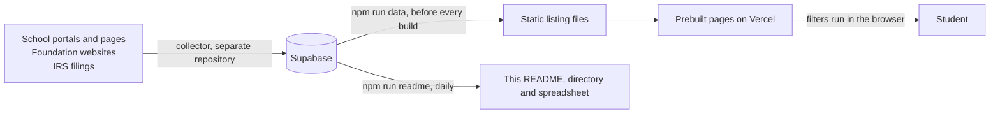

<div align="center">
  

  <h1>GoldenScholarship</h1>

  <p><b>The scholarships worth applying to.</b><br />
  A free, open directory of the scholarships US colleges give their own students,<br />
  plus the ones open to students at any school. No account, no sponsored listings.</p>

  
  
  
  
  
  
  

  <p>
    <a href="https://goldenscholarship.com"><b>Use the site</b></a> ·
    <a href="directory/README.md">Browse by school</a> ·
    <a href="directory/any-school.md">Open to any school</a> ·
    <a href="data/scholarships.csv">Download the data</a> ·
    <a href="../../issues/new">Report a problem</a>
  </p>

  <table>
    <tr>
      <td align="center"><b>143,796</b><br /><sub>scholarships</sub></td>
      <td align="center"><b>2,210</b><br /><sub>schools</sub></td>
      <td align="center"><b>11,492</b><br /><sub>foundations</sub></td>
      <td align="center"><b>54,899</b><br /><sub>open right now</sub></td>
    </tr>
  </table>

  <sub>Listings updated Nov 26, 2026. This page, the directory and the spreadsheet are rebuilt from the database every day.</sub>
</div>

## Contents

- [Why this exists](#why-this-exists)
- [What you get](#what-you-get)
- [Closing soon](#closing-soon)
- [How it works](#how-it-works)
- [Tech stack](#tech-stack)
- [Run it yourself](#run-it-yourself)
- [Project layout](#project-layout)
- [Contributing](#contributing)

## Why this exists

Most scholarship sites list the same national awards under every school's name. The ones you can actually win are usually smaller and closer to home: a department award, a donor fund, a local foundation. They sit on pages nobody links to, inside a school's application portal, or in a foundation's tax filing.

GoldenScholarship collects those into one list, with deadlines, amounts and a direct link to the official page for each one.

## What you get

- **Your school's own scholarships.** Type a school and see what it gives out, with its own awards listed first.
- **Scholarships open to any school.** 29,482 from community foundations and organisations.
- **Filters that hide what you can't apply for.** Five quick questions (year, field, GPA, need, and anything else about you) remove the ones that don't fit. Requirements we can't check are shown as labels on the listing.
- **No account.** Answers stay in your browser. Leaving an email for updates is optional.
- **No sponsored listings.** Nothing is ranked by who paid.
- **Open data.** Every listing is in [one spreadsheet](data/scholarships.csv) and in the [directory](directory/README.md) in this repository.
- **Readable by search engines and AI assistants.** Each scholarship has its own page with structured data, and the site publishes `llms.txt` files and sitemaps.

## Closing soon

<details open>
<summary><b>At a school</b> (soonest 100 deadlines, at most three per school)</summary>

| Scholarship | School | Amount | Deadline |
| --- | --- | --- | --- |
| [Ellucian PATH Scholarship](https://eiu.academicworks.com/opportunities/22819) | [Eastern Illinois University](directory/IL/eastern-illinois-university-144892.md) |  | Nov 27, 2026 |
| [Francis and Jacqueline Miller Service Award](https://slu.academicworks.com/opportunities/23272) | [Saint Louis University](directory/MO/saint-louis-university-179159.md) | $1,000 | Nov 27, 2026 |
| [Student Enrichment Services (SES) Winter Gear Program](https://northwestern.academicworks.com/opportunities/2773) | [Northwestern University](directory/IL/northwestern-university-147767.md) | $300 | Nov 27, 2026 |
| [Connie Grossman - Dental Hygiene Scholarship](https://cscc.academicworks.com/opportunities/8386) | [Columbus State Community College](directory/OH/columbus-state-community-college-202222.md) | $500 | Nov 28, 2026 |
| [The Jerry and Mary Keating Endowed Scholarship in Statistics](https://utsa.academicworks.com/opportunities/13656) | [The University of Texas at San Antonio](directory/TX/university-of-texas-at-san-antonio-229027.md) |  | Nov 28, 2026 |
| [Master of Science in International Real Estate Scholarships](https://business.fiu.edu/academics/graduate/international-real-estate/scholarships/index.html) | [Florida International University](directory/FL/florida-international-university-133951.md) | $7,500 | Nov 29, 2026 |
| [Michael E. Hurst Scholarship](https://fiu.academicworks.com/opportunities/22976) | [Florida International University](directory/FL/florida-international-university-133951.md) |  | Nov 29, 2026 |
| [William Dienstein Library Work Scholarship](https://fresnostate.academicworks.com/opportunities/32565) | [California State University-Fresno](directory/CA/california-state-university-fresno-110556.md) |  | Nov 29, 2026 |
| [CSCMP & Master in Logistics & Supply Chain Management Program Scholarship](https://fiu.academicworks.com/opportunities/22824) | [Florida International University](directory/FL/florida-international-university-133951.md) | $5,000 | Nov 29, 2026 |
| [Student Research Grants Competition - Conference Presentation Funds](https://wisc.academicworks.com/opportunities/114641) | [University of Wisconsin-Madison](directory/WI/university-of-wisconsin-madison-240444.md) | $600–$1,500 | Nov 29, 2026 |
| [Dan Kelly Memorial Scholarship](https://slu.academicworks.com/opportunities/23297) | [Saint Louis University](directory/MO/saint-louis-university-179159.md) | $1,500 | Nov 29, 2026 |
| [Astronaut Scholarship](https://students.tufts.edu/academic-advising-and-undergraduate-studies/scholarship-and-research/prestigious-nationally-competitive-awards) | [Tufts University](directory/MA/tufts-university-168148.md) |  | Nov 29, 2026 |
| [Juris Master General Scholarships](https://fsu.academicworks.com/opportunities/43073) | [Florida State University](directory/FL/florida-state-university-134097.md) |  | Nov 29, 2026 |
| [Schaberg Entrepreneurship Scholar Program FY27 A21610](https://msu.academicworks.com/opportunities/59443) | [Michigan State University](directory/MI/michigan-state-university-171100.md) | $2,500 | Nov 29, 2026 |
| [Student Research Grants Competition - Research Travel Funds](https://wisc.academicworks.com/opportunities/114643) | [University of Wisconsin-Madison](directory/WI/university-of-wisconsin-madison-240444.md) | $600–$1,500 | Nov 29, 2026 |
| [Dr. No-Hee Park Award for Excellence](https://ucla.academicworks.com/opportunities/129202) | [University of California-Los Angeles](directory/CA/university-of-california-los-angeles-110662.md) |  | Nov 29, 2026 |
| [Leadership Scholarship](https://www.olivet.edu/leadership-scholarship/) | [Olivet Nazarene University](directory/IL/olivet-nazarene-university-147828.md) |  | Nov 29, 2026 |
| [Key Lime Festival Scholarship](https://cfk.academicworks.com/opportunities/3680) | [The College of the Florida Keys](directory/FL/college-of-the-florida-keys-133960.md) | $1,550 | Nov 29, 2026 |
| [Northwestern Career Advancement - Career Development Fund (CDF): Graduate/Professional School Test Prep and Application Fee Support](https://northwestern.academicworks.com/opportunities/2797) | [Northwestern University](directory/IL/northwestern-university-147767.md) | $550 | Nov 29, 2026 |
| [Phi Eta Sigma Scholarship](https://salisbury.academicworks.com/opportunities/5824) | [Salisbury University](directory/MD/salisbury-university-163851.md) | $250–$400 | Nov 29, 2026 |
| [L&S Honors Conference Travel Grant](https://wisc.academicworks.com/opportunities/106390) | [University of Wisconsin-Madison](directory/WI/university-of-wisconsin-madison-240444.md) | $500 | Nov 29, 2026 |
| [Northwestern Career Advancement - Career Development Fund (CDF): Interview Suit Application for internship or full-time job opportunities and career-related events](https://northwestern.academicworks.com/opportunities/2801) | [Northwestern University](directory/IL/northwestern-university-147767.md) | $300 | Nov 29, 2026 |
| [UAW Terry Lint Memorial Scholarship](https://grcc.academicworks.com/opportunities/9794) | [Grand Rapids Community College](directory/MI/grand-rapids-community-college-170055.md) |  | Nov 30, 2026 |
| [Gallatin College MSU Scholarship (Spring)](https://montana.academicworks.com/opportunities/26303) | [Montana State University](directory/MT/montana-state-university-180461.md) |  | Nov 30, 2026 |
| [Kugelman Honors Program Scholarship](https://uwf.academicworks.com/opportunities/9120) | [University of West Florida](directory/FL/university-of-west-florida-138354.md) | $1,000 | Nov 30, 2026 |
| [Paul Wiese Memorial Scholarship](https://sfsu.academicworks.com/opportunities/23874) | [San Francisco State University](directory/CA/san-francisco-state-university-122597.md) | $2,500 | Nov 30, 2026 |
| [Jane G. and Fred K. Seligman Scholarship](https://uwf.academicworks.com/opportunities/9419) | [University of West Florida](directory/FL/university-of-west-florida-138354.md) | $1,000 | Nov 30, 2026 |
| [DCHS Cura Student Scholarship](https://slu.academicworks.com/opportunities/23299) | [Saint Louis University](directory/MO/saint-louis-university-179159.md) |  | Nov 30, 2026 |
| [Presidential High-Impact Learning Experience Awards](https://salisbury.academicworks.com/opportunities/5330) | [Salisbury University](directory/MD/salisbury-university-163851.md) | $1,200 | Nov 30, 2026 |
| [LABASH '89 Student Development Scholarship Fund](https://lsu.academicworks.com/opportunities/47289) | [Louisiana State University and Agricultural & Mechanical College](directory/LA/louisiana-state-university-and-agricultural-and-mechanical-college-159391.md) |  | Nov 30, 2026 |
| [Continuing Education Scholarship](https://pgcc.academicworks.com/opportunities/3654) | [Prince George's Community College](directory/MD/prince-george-s-community-college-163657.md) | $250–$500 | Nov 30, 2026 |
| [COD Succeeds Scholarship](https://cod.academicworks.com/opportunities/7197) | [College of DuPage](directory/IL/college-of-dupage-144865.md) | $500 | Nov 30, 2026 |
| [Lovgren HVAC-R Scholarship](https://montana.academicworks.com/opportunities/28040) | [Montana State University](directory/MT/montana-state-university-180461.md) |  | Nov 30, 2026 |
| [The National Association of Black Accountants (NABA) Scholarship](https://sfsu.academicworks.com/opportunities/23392) | [San Francisco State University](directory/CA/san-francisco-state-university-122597.md) | $1,000 | Nov 30, 2026 |
| [LARK Culinary Arts Scholarship](https://montana.academicworks.com/opportunities/27932) | [Montana State University](directory/MT/montana-state-university-180461.md) |  | Nov 30, 2026 |
| Robert R Meyer Jr Memorial Scholarship Fund | [Princeton University](directory/NJ/princeton-university-186131.md) |  | Nov 30, 2026 |
| [Chris and Debbie Smith Pharmacy Scholarship Endowment](https://siue.academicworks.com/opportunities/19457) | [Southern Illinois University Edwardsville](directory/IL/southern-illinois-university-edwardsville-149231.md) | $6,000 | Nov 30, 2026 |
| [Rick Dudley Scholarship Fund for Graduate Students with Disabilities](https://salisbury.academicworks.com/opportunities/5317) | [Salisbury University](directory/MD/salisbury-university-163851.md) | $750 | Nov 30, 2026 |
| [AARP - Erickson School Scholarship](https://umbc.academicworks.com/opportunities/9197) | [University of Maryland-Baltimore County](directory/MD/university-of-maryland-baltimore-county-163268.md) |  | Nov 30, 2026 |
| [Chester and Helen Carkoski Scholarship](https://mnsu.academicworks.com/opportunities/23272) | [Minnesota State University-Mankato](directory/MN/minnesota-state-university-mankato-173920.md) | $1,000 | Nov 30, 2026 |
| [Presidential Scholarship](https://financialaid.buffalostate.edu/scholarships-fall-2024-and-prior) | [SUNY Buffalo State University](directory/NY/suny-buffalo-state-university-196130.md) |  | Nov 30, 2026 |
| [Erickson School Graduate Fellowship Fund](https://umbc.academicworks.com/opportunities/9203) | [University of Maryland-Baltimore County](directory/MD/university-of-maryland-baltimore-county-163268.md) |  | Nov 30, 2026 |
| [Dr. Prem S. Virdi M.D. Health Sciences and Nursing Scholarship](https://www.unitypoint.org/quadcities/apply-for-a-scholarship.aspx) | [Trinity College of Nursing & Health Sciences](directory/IL/trinity-college-of-nursing-and-health-sciences-146755.md) |  | Nov 30, 2026 |
| [Academic Excellence Scholarship for San Francisco State Scholars Program in Accounting](https://sfsu.academicworks.com/opportunities/23865) | [San Francisco State University](directory/CA/san-francisco-state-university-122597.md) | $1,000 | Nov 30, 2026 |
| [Applied Ethics and National Security Endowed Scholarship](https://towson.academicworks.com/opportunities/10308) | [Towson University](directory/MD/towson-university-164076.md) | $2,000 | Nov 30, 2026 |
| [The Frances M. Webb Endowed Scholarship for Student-Parents](https://hostos.academicworks.com/opportunities/5525) | [CUNY Hostos Community College](directory/NY/cuny-hostos-community-college-190585.md) | $500 | Nov 30, 2026 |
| [The Honorable Hector L. Diaz Scholarship](https://hostos.academicworks.com/opportunities/5537) | [CUNY Hostos Community College](directory/NY/cuny-hostos-community-college-190585.md) | $2,500 | Nov 30, 2026 |
| [School Social Work Scholarship](https://www.bethel.edu/adult-undergrad/financial-aid/types/grants-scholarships/) | [Bethel University](directory/MN/bethel-university-173160.md) | $15,000 | Nov 30, 2026 |
| [Joe and Jane Owen Scholarship in Economics](https://depaul.academicworks.com/opportunities/58070) | [DePaul University](directory/IL/depaul-university-144740.md) | $2,500 | Nov 30, 2026 |
| [Greehey Fellows Scholarship](https://www.stmarytx.edu/academics/business/programs-and-centers/greehey-fellows-scholarship/) | [St. Mary's University](directory/TX/st-mary-s-university-228149.md) | $20,000 | Nov 30, 2026 |
| [Andrea M. Daugherty Memorial Travel Award in Interior Design](https://lsu.academicworks.com/opportunities/46550) | [Louisiana State University and Agricultural & Mechanical College](directory/LA/louisiana-state-university-and-agricultural-and-mechanical-college-159391.md) |  | Nov 30, 2026 |
| [Marinus Swets Scholarship](https://grcc.academicworks.com/opportunities/9613) | [Grand Rapids Community College](directory/MI/grand-rapids-community-college-170055.md) |  | Nov 30, 2026 |
| [Helen Beuker & Barb LaBelle Scholarship](https://grcc.academicworks.com/opportunities/9366) | [Grand Rapids Community College](directory/MI/grand-rapids-community-college-170055.md) | $2,000 | Nov 30, 2026 |
| [Officer Robert Doeden Policing Studies Equipment Fund](https://mnsu.academicworks.com/opportunities/24628) | [Minnesota State University-Mankato](directory/MN/minnesota-state-university-mankato-173920.md) | $1,000 | Nov 30, 2026 |
| [Chancellor's Scholarships for Entering First-Year](https://fas.ucsd.edu/types/scholarships/chancellors-scholarships-for-entering-freshmen.html) | [University of California-San Diego](directory/CA/university-of-california-san-diego-110680.md) | $5,000 | Nov 30, 2026 |
| [Ralph, Marian and Pamela Erk Memorial Endowed Scholarship](https://msstate.academicworks.com/opportunities/86585) | [Mississippi State University](directory/MS/mississippi-state-university-176080.md) |  | Nov 30, 2026 |
| [Charles County "Commissioners Care" Scholarship](https://csmd.academicworks.com/opportunities/7464) | [College of Southern Maryland](directory/MD/college-of-southern-maryland-162122.md) | $1,000 | Nov 30, 2026 |
| [Wampner-Hoffmyer Scholarship](https://www.csl.edu/admissions/financial-aid/scholarships/all-scholarships/) | [Concordia Seminary](directory/MO/concordia-seminary-177092.md) |  | Nov 30, 2026 |
| [UC Irvine Distinguished Scholarships Category](https://www.ofas.uci.edu/scholarships/applying-for-scholarships.php) | [University of California-Irvine](directory/CA/university-of-california-irvine-110653.md) |  | Nov 30, 2026 |
| [The Darlene Miller Foundation Merit Scholarship](https://coppin.academicworks.com/opportunities/4398) | [Coppin State University](directory/MD/coppin-state-university-162283.md) | $1,500 | Nov 30, 2026 |
| [De Anza Academic Awareness Program Scholarship](https://fhda.academicworks.com/opportunities/10651) | [Foothill-De Anza Community College District](directory/CA/foothill-de-anza-community-college-district-114831.md) | $300 | Nov 30, 2026 |
| [Peggy Searight Memorial Scholarship](https://csun.academicworks.com/opportunities/7575) | [California State University-Northridge](directory/CA/california-state-university-northridge-110608.md) | $1,000 | Nov 30, 2026 |
| [Dr. Albin O. Kuhn Scholarship Endowment](https://umbc.academicworks.com/opportunities/9201) | [University of Maryland-Baltimore County](directory/MD/university-of-maryland-baltimore-county-163268.md) |  | Nov 30, 2026 |
| [Jack Rettig International Scholarship](https://lsu.academicworks.com/opportunities/45136) | [Louisiana State University and Agricultural & Mechanical College](directory/LA/louisiana-state-university-and-agricultural-and-mechanical-college-159391.md) |  | Nov 30, 2026 |
| [EOF Child Care Grant 2026-2027](https://ku.academicworks.com/opportunities/49931) | [University of Kansas](directory/KS/university-of-kansas-155317.md) |  | Nov 30, 2026 |
| [Provost Scholarship](https://financialaid.buffalostate.edu/scholarships-fall-2024-and-prior) | [SUNY Buffalo State University](directory/NY/suny-buffalo-state-university-196130.md) | $2,000 | Nov 30, 2026 |
| [Haub School of Environment and Natural Resources Student Research and Creative Activities Grant](https://uwyo.academicworks.com/opportunities/51422) | [University of Wyoming](directory/WY/university-of-wyoming-240727.md) | $1,000 | Nov 30, 2026 |
| [James Hansen Memorial Endowment Fund](https://buffalo.academicworks.com/opportunities/26771) | [University at Buffalo](directory/NY/university-at-buffalo-196088.md) |  | Nov 30, 2026 |
| [David Laude Scholarship](https://utexas.scholarships.ngwebsolutions.com/Scholarships/Search) | [The University of Texas at Austin](directory/TX/university-of-texas-at-austin-228778.md) |  | Nov 30, 2026 |
| [Alexander D. Daunis Memorial Scholarship](https://uri.academicworks.com/opportunities/18144) | [University of Rhode Island](directory/RI/university-of-rhode-island-217484.md) |  | Nov 30, 2026 |
| [OCC Annual Scholarships](https://orangecoastcollege.edu/services-support/scholarship/occ-scholarships.html) | [Orange Coast College](directory/CA/orange-coast-college-120342.md) |  | Nov 30, 2026 |
| [Bronstad, Joseph A Study Abroad Scholarship](https://umassd.scholarships.ngwebsolutions.com/Scholarships/Search) | [University of Massachusetts-Dartmouth](directory/MA/university-of-massachusetts-dartmouth-167987.md) |  | Nov 30, 2026 |
| [Shannon Marie & Louis Porter Smith Foundation Scholarship](https://www.uwsp.edu/wausau/wausau-scholarships/) | [University of Wisconsin-Stevens Point](directory/WI/university-of-wisconsin-stevens-point-240480.md) | $1,000 | Nov 30, 2026 |
| [The Manuel Gonzalo Coballes Scholarship Fund for Allied Health Students](https://hostos.academicworks.com/opportunities/5541) | [CUNY Hostos Community College](directory/NY/cuny-hostos-community-college-190585.md) | $500 | Nov 30, 2026 |
| [In-state scholarships at UIdaho](https://www.uidaho.edu/financial-aid/scholarships/in-state-scholarship) | [University of Idaho](directory/ID/university-of-idaho-142285.md) | $4,000 | Nov 30, 2026 |
| [The Dr. Delores Kelley Endowed Scholarship](https://coppin.academicworks.com/opportunities/4395) | [Coppin State University](directory/MD/coppin-state-university-162283.md) |  | Nov 30, 2026 |
| [Paul Rickard Memorial Academic Scholarship](https://sunyorange.academicworks.com/opportunities/5941) | [Orange County Community College](directory/NY/orange-county-community-college-194240.md) | $1,000 | Nov 30, 2026 |
| [Bengal Scholarship](https://financialaid.buffalostate.edu/scholarships-fall-2024-and-prior) | [SUNY Buffalo State University](directory/NY/suny-buffalo-state-university-196130.md) | $1,000 | Nov 30, 2026 |
| [MSW Social Work Scholarship](https://www.bethel.edu/graduate/financial-aid/types/grants-scholarships/) | [Bethel University](directory/MN/bethel-university-173160.md) | $15,000 | Nov 30, 2026 |
| [Leslie Geraldine Sherman Memorial Scholarship](https://vt.academicworks.com/opportunities/75580) | [Virginia Polytechnic Institute and State University](directory/VA/virginia-polytechnic-institute-and-state-university-233921.md) |  | Nov 30, 2026 |
| [Focused Driver Scholarship](https://www.cuaa.edu/admissions/financial-aid/scholarships-grants.html) | [Concordia University Ann Arbor](directory/MI/concordia-university-ann-arbor-169363.md) | $1,000 | Nov 30, 2026 |
| [Paul L. & Lynne Taylor Knox Study Abroad Scholarship](https://vt.academicworks.com/opportunities/75582) | [Virginia Polytechnic Institute and State University](directory/VA/virginia-polytechnic-institute-and-state-university-233921.md) |  | Nov 30, 2026 |
| [Kathleen Yosko Nursing Excellence Scholarship](https://cod.academicworks.com/opportunities/7339) | [College of DuPage](directory/IL/college-of-dupage-144865.md) | $10,000 | Nov 30, 2026 |
| [Focused Driver Scholarship](https://www.cuw.edu/admissions/financial-aid/scholarships-grants.html) | [Concordia University-Wisconsin](directory/WI/concordia-university-wisconsin-238616.md) | $1,000 | Nov 30, 2026 |
| [Near Completer Carnegie Grant](https://ubalt.academicworks.com/opportunities/3950) | [University of Baltimore](directory/MD/university-of-baltimore-161873.md) |  | Nov 30, 2026 |
| [40&8 Nurses Training Scholarship](https://frederick.academicworks.com/opportunities/9944) | [Frederick Community College](directory/MD/frederick-community-college-162557.md) | $500 | Nov 30, 2026 |
| [Mid-Atlantic CIO Forum Scholarship](https://towson.academicworks.com/opportunities/10474) | [Towson University](directory/MD/towson-university-164076.md) |  | Nov 30, 2026 |
| [The David M. Sperling DREAM Foundation Scholarship](https://ncc.academicworks.com/opportunities/5125) | [Nassau Community College](directory/NY/nassau-community-college-193478.md) | $1,000 | Nov 30, 2026 |
| [John C. Pace, Jr. Scholars](https://uwf.academicworks.com/opportunities/9055) | [University of West Florida](directory/FL/university-of-west-florida-138354.md) | $3,000 | Nov 30, 2026 |
| [Regents Scholarships for Entering Freshmen](https://fas.ucsd.edu/types/scholarships/regents-scholarships-for-entering-freshmen.html) | [University of California-San Diego](directory/CA/university-of-california-san-diego-110680.md) | $5,000 | Nov 30, 2026 |
| [Sociology Department Scholarship Awards](https://csun.academicworks.com/opportunities/7596) | [California State University-Northridge](directory/CA/california-state-university-northridge-110608.md) | $250–$500 | Nov 30, 2026 |
| [Fall and Spring awards](https://www.cmich.edu/offices-departments/office-scholarships-financial-aid/scholarships/scholarship-universe/scholarship-universe-assistance) | [Central Michigan University](directory/MI/central-michigan-university-169248.md) |  | Nov 30, 2026 |
| [Justice in Family Law Scholarship](https://law.mc.edu/admissions/tuition-financial-aid/scholarships) | [Mississippi College](directory/MS/mississippi-college-176053.md) |  | Nov 30, 2026 |
| [Robert Adam Erk Memorial Endowed Scholarship](https://msstate.academicworks.com/opportunities/86583) | [Mississippi State University](directory/MS/mississippi-state-university-176080.md) |  | Nov 30, 2026 |
| [Alvin College Health Information Management Department Scholarship](https://alvincollege.academicworks.com/opportunities/2810) | [Alvin Community College](directory/TX/alvin-community-college-222567.md) | $500 | Nov 30, 2026 |
| [Matt Winn EHSS Memorial Scholarship](https://csun.academicworks.com/opportunities/7573) | [California State University-Northridge](directory/CA/california-state-university-northridge-110608.md) | $2,500–$10,000 | Nov 30, 2026 |
| [College of Arts and Sciences Study Abroad Awards - Summer Semester Abroad](https://fsu.academicworks.com/opportunities/43754) | [Florida State University](directory/FL/florida-state-university-134097.md) | $4,000 | Nov 30, 2026 |
| [Emery Reddy Legal Studies Scholarship (Annual Scholarship)](https://www.mckendree.edu/offices/financial-aid/undergraduate/first-year/additional-scholarships.php) | [McKendree University](directory/IL/mckendree-university-147013.md) | $1,000 | Nov 30, 2026 |
| [Critical Language Scholarship](https://uged.ucsb.edu/national-scholarships) | [University of California-Santa Barbara](directory/CA/university-of-california-santa-barbara-110705.md) |  | Nov 30, 2026 |
| [Griswold Home Care Annual Scholarship](https://apps.thomasmore.edu/WebApps/Scholarships/?id=176) | [Thomas More University](directory/KY/thomas-more-university-157809.md) | $1,000 | Nov 30, 2026 |

</details>

<details>
<summary><b>Open to any school</b></summary>

| Scholarship | From | Amount | Deadline |
| --- | --- | --- | --- |
| [SEMCA Scholarship](https://www.semcaschool.org/scholarships) | Construction Education Trust |  | Nov 27, 2026 |
| [Future of Connectivity Essay Scholarship](https://www.zipitwireless.com/scholarship) | Zipit Wireless | $2,500 | Nov 27, 2026 |
| [Compeer Financial High School Senior Scholarship](https://www.compeer.com/investing-in-rural-communities/giving-back/scholarships/high-school-senior-scholarships) | Compeer Financial | $2,000 | Nov 27, 2026 |
| [NEWH Cincinnati Region Scholarship](https://newh.org/scholarships/available/page/2/) | NEWH, Inc. - The Hospitality Industry Network | $10,000 | Nov 27, 2026 |
| [NEWH \| Cincinnati Chapter Scholarship](https://newh.org/directory/newh-cincinnati-region-scholarship/) | NEWH: The Hospitality Industry Network - Cincinnati Chapter | $7,500 | Nov 27, 2026 |
| [Future of Connectivity Scholarship](https://www.accesslex.org/databank) | Accesslex Institute | $2,500 | Nov 27, 2026 |
| [Farm House Excellence in Horsemanship Scholarship](https://www.farmhousetack.com/pages/equestrian-scholarship?srsltid=AfmBOooUCc-vpI9NEq1i6aucTNK6r6OiWCit_4OR8lW081dqCf588tKM) | Farm House Tack | $2,000 | Nov 27, 2026 |
| [Allen Tittle's Medical Malpractice Scholarship](https://www.accesslex.org/databank) | Tittle & Perlmuter |  | Nov 28, 2026 |
| [Winter Program Fee Scholarship](https://www.sswsc.org/parent-athlete-resources/program-fee-scholarships/) | Steamboat Springs Winter Sports Club Inc |  | Nov 28, 2026 |
| [GS(cor)P Scholarship](https://www.thecorp.org/scholarships) | Students of Georgetown Inc |  | Nov 29, 2026 |
| [Deb & John Quirk Memorial Scholarship](https://www.hastingscommunityfoundation.org/scholarships) | Hastings Community Foundation | $40,000 | Nov 29, 2026 |
| [Arizona School Counselors Association High School Student Scholarship](https://www.azsca.org/i4a/pages/index.cfm?pageid=3317) | Arizona School Counselors Association | $2,000 | Nov 29, 2026 |
| [Timothy P O'Shaughnessy Foundation](https://timposhfoundation.org/) | Timothy P O'Shaughnessy Foundation |  | Nov 30, 2026 |
| [Daniel J. and Robert E. Klein Scholarship](https://www.npmapestworld.org/content-pages/scholarships/daniel-j-and-robert-e-klein-scholarship/) | National Pest Management Association (NPMA) | $1,000 | Nov 30, 2026 |
| [$1,500 Easy Scholarship: Offline Mode](https://dosomething.org/action/offline-mode) | DoSomething | $1,500 | Nov 30, 2026 |
| [Dr. Juan Andrade Scholarship for Young Hispanic Leaders](https://www.bartlesvillescholars.org/scholarship-lookup) | Young Scholars of Bartlesville Inc | $1,000 | Nov 30, 2026 |
| [Therapy.com Mental Health Scholarship](https://www.bartlesvillescholars.org/scholarship-lookup) | Young Scholars of Bartlesville Inc | $2,250 | Nov 30, 2026 |
| [TCGIS Capstone Trip Scholarship](https://www.gaimn.org/scholarships) | Germanic-American Institute |  | Nov 30, 2026 |
| [Cooke Foundation College Scholarship](https://cfcga.org/for-students/other-local-scholarships/) | Community Foundation of Central Georgia |  | Nov 30, 2026 |
| Cheon Am Scholarship Foundation | Cheon Am Scholarship Foundation | $1,000 | Nov 30, 2026 |
| Frye Family Foundation | Frye Family Foundation |  | Nov 30, 2026 |
| [All-American Pest Control STEAM Trailblazer Scholarship](https://www.allamericanpestcontrol.com/steam-scholarship) | All-American Pest Control | $50,000 | Nov 30, 2026 |
| [Rumba Meats USHLI Scholarship](https://www.bartlesvillescholars.org/scholarship-lookup) | Young Scholars of Bartlesville Inc | $1,000 | Nov 30, 2026 |
| [Don Quijote Education Scholarship](https://pccf.gives/scholarships/) | Porter County Community Foundation Inc |  | Nov 30, 2026 |
| [Emily and Hugh Kendrick Family Scholarship](https://www.npmapestworld.org/content-pages/scholarships/emily-and-hugh-kendrick-family-scholarship/) | National Pest Management Association (NPMA) | $1,000 | Nov 30, 2026 |
| [Future Leadership Scholarship](https://www.jacksoncf.org/scholarships) | Jackson Community Foundation |  | Nov 30, 2026 |
| [NTGCR Scholarships](https://www.ntgcr.com/scholarships) | National Tribal Gaming Commissioners Regulators | $2,500 | Nov 30, 2026 |
| [PMI Minnesota Scholarship](https://www.pmi-mn.org/) | Project Management Institute | $2,500 | Nov 30, 2026 |
| [PNA Scholarships for Post-Undergraduate Studies in Aging](https://pnamidsouth.org/pna-scholarship/) | Memphis & Shelby County Council on Aging Inc | $7,000 | Nov 30, 2026 |
| [Wisconsin Roofing Contractors Association Scholarship](https://wrcaonline.org/scholarship/) | Wisconsin Roofing Contractors Association (WRCA) | $1,500 | Nov 30, 2026 |
| [RehabSeekers Scholarship](https://www.kirkwood.edu/get-started/paying-for-college/scholarships/external-scholarships) | RehabSeekers | $2,000 | Nov 30, 2026 |
| [John Galt Scholarship for Future Supply Chain Leaders](https://johngalt.com/scholarships) | John Galt Solutions | $10,000 | Nov 30, 2026 |
| [Michele Hudson St. Patrick Preschool Scholarship](https://www.miamicountyfoundation.org/scholarships/current-scholarships) | Miami County Foundation |  | Nov 30, 2026 |
| [Arrow Exterminators Endowed Scholarship](https://www.npmapestworld.org/content-pages/scholarships/arrow-exterminators-scholarship/) | Arrow Exterminators | $1,000 | Nov 30, 2026 |
| Lincoln Foundation | Lincoln Foundation |  | Nov 30, 2026 |
| [All-American Pest Control STEAM Trailblazer Scholarship](https://www.npmapestworld.org/content-pages/scholarships/all-american-pest-control-steam-trailblazer-scholarship/) | National Pest Management Association (NPMA) | $1,000 | Nov 30, 2026 |
| Diamond Jubilee Fund of Ksb 232 Fam | Diamond Jubilee Fund of Ksb 232 Fam |  | Nov 30, 2026 |
| [United States Based Academic Scholarships](https://isaca.secure-platform.com/2027awardrecipients/page/ISACAfoundation/aboutscholarships) | Information Systems Audit and Control Association Inc Group |  | Nov 30, 2026 |
| [Space to Succeed Scholarship](https://thestoragecenter.com/self-storage/scholarship/) | The Storage Center | $8,500 | Nov 30, 2026 |
| Miner Charitable Foundation Inc | Miner Charitable Foundation Inc |  | Nov 30, 2026 |

[All 29,482 open to any school →](directory/any-school.md)

</details>

<details>
<summary><b>Schools with the most open right now</b></summary>

| School | State | Open |
| --- | --- | ---: |
| [The University of Alabama](directory/AL/university-of-alabama-100751.md) | AL | 2,460 |
| [Colorado State University-Fort Collins](directory/CO/colorado-state-university-fort-collins-126818.md) | CO | 1,818 |
| [North Dakota State University-Main Campus](directory/ND/north-dakota-state-university-main-campus-200332.md) | ND | 1,504 |
| [University of North Dakota](directory/ND/university-of-north-dakota-200280.md) | ND | 1,388 |
| [Western Kentucky University](directory/KY/western-kentucky-university-157951.md) | KY | 1,259 |
| [Montana State University](directory/MT/montana-state-university-180461.md) | MT | 1,246 |
| [East Carolina University](directory/NC/east-carolina-university-198464.md) | NC | 1,166 |
| [University of Wisconsin-Milwaukee](directory/WI/university-of-wisconsin-milwaukee-240453.md) | WI | 1,066 |
| [Southern Illinois University-Carbondale](directory/IL/southern-illinois-university-carbondale-149222.md) | IL | 997 |
| [University of Missouri-Kansas City](directory/MO/university-of-missouri-kansas-city-178402.md) | MO | 908 |
| [Calvin University](directory/MI/calvin-university-169080.md) | MI | 885 |
| [California State University-Fresno](directory/CA/california-state-university-fresno-110556.md) | CA | 851 |
| [University of Arkansas](directory/AR/university-of-arkansas-106397.md) | AR | 745 |
| [Sam Houston State University](directory/TX/sam-houston-state-university-227881.md) | TX | 742 |
| [George Washington University](directory/DC/george-washington-university-131469.md) | DC | 729 |
| [University of Nebraska at Omaha](directory/NE/university-of-nebraska-at-omaha-181394.md) | NE | 710 |
| [California State University-Sacramento](directory/CA/california-state-university-sacramento-110617.md) | CA | 698 |
| [University of Northern Colorado](directory/CO/university-of-northern-colorado-127741.md) | CO | 688 |
| [Florida State University](directory/FL/florida-state-university-134097.md) | FL | 666 |
| [University of Central Missouri](directory/MO/university-of-central-missouri-176965.md) | MO | 661 |
| [Texas Woman's University](directory/TX/texas-woman-s-university-229179.md) | TX | 614 |
| [Eastern Illinois University](directory/IL/eastern-illinois-university-144892.md) | IL | 592 |
| [University of Colorado Boulder](directory/CO/university-of-colorado-boulder-126614.md) | CO | 572 |
| [University of Wisconsin-Platteville](directory/WI/university-of-wisconsin-platteville-240462.md) | WI | 562 |
| [University of Memphis](directory/TN/university-of-memphis-220862.md) | TN | 529 |
| [Xavier University](directory/OH/xavier-university-206622.md) | OH | 512 |
| [San Mateo County Community College District Office](directory/CA/san-mateo-county-community-college-district-office-122782.md) | CA | 495 |
| [North Carolina State University at Raleigh](directory/NC/north-carolina-state-university-at-raleigh-199193.md) | NC | 483 |
| [Wayne State College](directory/NE/wayne-state-college-181783.md) | NE | 459 |
| [Arkansas State University](directory/AR/arkansas-state-university-106458.md) | AR | 455 |
| [Radford University](directory/VA/radford-university-233277.md) | VA | 453 |
| [Montgomery College](directory/MD/montgomery-college-163426.md) | MD | 452 |
| [University of Wisconsin-Madison](directory/WI/university-of-wisconsin-madison-240444.md) | WI | 428 |
| [Frostburg State University](directory/MD/frostburg-state-university-162584.md) | MD | 419 |
| [East Central University](directory/OK/east-central-university-207041.md) | OK | 417 |
| [State University of New York at Cortland](directory/NY/state-university-of-new-york-at-cortland-196149.md) | NY | 411 |
| [Minot State University](directory/ND/minot-state-university-200253.md) | ND | 401 |
| [Lander University](directory/SC/lander-university-218229.md) | SC | 396 |
| [University of Wisconsin-River Falls](directory/WI/university-of-wisconsin-river-falls-240471.md) | WI | 384 |
| [Cape Fear Community College](directory/NC/cape-fear-community-college-198154.md) | NC | 382 |
| [Minnesota State University-Mankato](directory/MN/minnesota-state-university-mankato-173920.md) | MN | 379 |
| [Colorado Mesa University](directory/CO/colorado-mesa-university-127556.md) | CO | 378 |
| [SUNY Brockport](directory/NY/suny-brockport-196121.md) | NY | 360 |
| [Missouri Southern State University](directory/MO/missouri-southern-state-university-178341.md) | MO | 353 |
| [Glendale Community College](directory/CA/glendale-community-college-115001.md) | CA | 351 |
| [South Plains College](directory/TX/south-plains-college-228158.md) | TX | 347 |
| [Saginaw Valley State University](directory/MI/saginaw-valley-state-university-172051.md) | MI | 342 |
| [Allegany College of Maryland](directory/MD/allegany-college-of-maryland-161688.md) | MD | 341 |
| [Vance-Granville Community College](directory/NC/vance-granville-community-college-199838.md) | NC | 338 |
| [University of Central Arkansas](directory/AR/university-of-central-arkansas-106704.md) | AR | 337 |
| [Tyler Junior College](directory/TX/tyler-junior-college-229355.md) | TX | 318 |
| [Bemidji State University](directory/MN/bemidji-state-university-173124.md) | MN | 317 |
| [Northern Illinois University](directory/IL/northern-illinois-university-147703.md) | IL | 309 |
| [North Carolina Central University](directory/NC/north-carolina-central-university-199157.md) | NC | 274 |
| [Montana State University Billings](directory/MT/montana-state-university-billings-180179.md) | MT | 266 |
| [Southeastern Oklahoma State University](directory/OK/southeastern-oklahoma-state-university-207847.md) | OK | 262 |
| [SUNY College of Technology at Canton](directory/NY/suny-college-of-technology-at-canton-196015.md) | NY | 259 |
| [Salisbury University](directory/MD/salisbury-university-163851.md) | MD | 246 |
| [Stockton University](directory/NJ/stockton-university-186876.md) | NJ | 236 |
| [Hagerstown Community College](directory/MD/hagerstown-community-college-162690.md) | MD | 232 |

</details>

[All 2,210 schools →](directory/README.md)

## How it works



The site never queries the database while someone is browsing. Before each build, `npm run data` exports every listing into static files; the pages are built from those, and all filtering happens in the browser. The only requests that reach the database at runtime are the three small forms: email signup, problem reports, and searches that found nothing.

The data is early. Deadlines and amounts come straight from each listing and can be wrong or out of date, so check the official page before you apply.

## Tech stack

| Layer | What we use |
| --- | --- |
| Framework | [Next.js 16](https://nextjs.org) (App Router, cache components, Turbopack) with [React 19](https://react.dev) |
| Language | [TypeScript](https://www.typescriptlang.org) |
| Styling | [Tailwind CSS 4](https://tailwindcss.com) |
| Data | [Supabase](https://supabase.com) (Postgres), exported to static JSON at build time |
| Analytics | [PostHog](https://posthog.com), proxied through the site; optional |
| Hosting | [Vercel](https://vercel.com) |
| Automation | GitHub Actions, for the daily listing update |

## Run it yourself

You need Node.js 22.9 or newer and a Supabase project that holds the scholarship tables.

```bash
git clone https://github.com/v1m08/GoldenScholarships.git
cd GoldenScholarships
npm install
cp .env.example .env.local   # then fill in the values below
npm run data                 # exports the listings the site reads
npm run dev                  # http://localhost:3000
```

Run [`supabase/setup.sql`](supabase/setup.sql) once in the Supabase SQL editor to create the tables the site writes to.

### Environment variables

| Variable | Needed | What it is |
| --- | --- | --- |
| `SUPABASE_URL` | Yes | Your Supabase project address |
| `SUPABASE_SECRET_KEY` | Yes | Server-only key. It is never sent to the browser |
| `NEXT_PUBLIC_POSTHOG_KEY` | No | Leave empty to run without analytics |
| `POSTHOG_REGION` | No | `us` or `eu`, matching the PostHog project |
| `NEXT_PUBLIC_SITE_URL` | In production | The site's address, used for sitemaps, canonical links and share cards |
| `NEXT_PUBLIC_REPO_URL` | No | Shows a GitHub link on the site |

### Commands

| Command | What it does |
| --- | --- |
| `npm run dev` | Starts the site locally |
| `npm run data` | Exports the listings from the database into static files |
| `npm run build` | Runs the export, then builds the production site |
| `npm run readme` | Rebuilds this page, `directory/` and `data/scholarships.csv` |
| `npm run lint` | Checks the code |

## Project layout

```text
src/app/           pages and routes: home, schools, scholarships, stats, why, blog
src/components/    the search, the question flow, the filterable list, Penny
src/lib/           filtering rules, questions, data loading, share cards
scripts/           build-data.mjs (site export) and build-readme.mjs (this page)
supabase/          setup.sql for the tables the site writes to
directory/         every school's open scholarships as Markdown, by state
data/              scholarships.csv, everything in one file
```

## Contributing

- **Found a mistake, or is your school missing?** [Open an issue](../../issues/new) with the school and the link. Missing schools are collected in the order people ask for them.
- **Want to change the site?** Fork the repository, make the change on a branch and open a pull request. Run `npm run lint` and `npm run build` first.
- **Do not edit `README.md`, `directory/` or `data/` by hand.** They are generated; change `scripts/build-readme.mjs` instead.

<div align="center">
  <sub>Built by students who have been through it. Every link goes to the official page. No signup, no sweepstakes.</sub>
</div>
